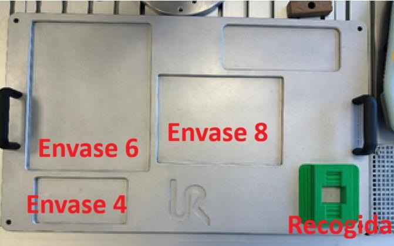
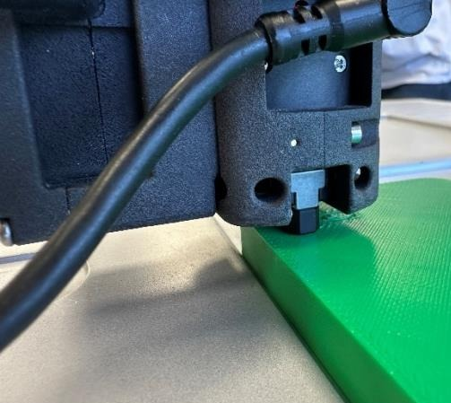
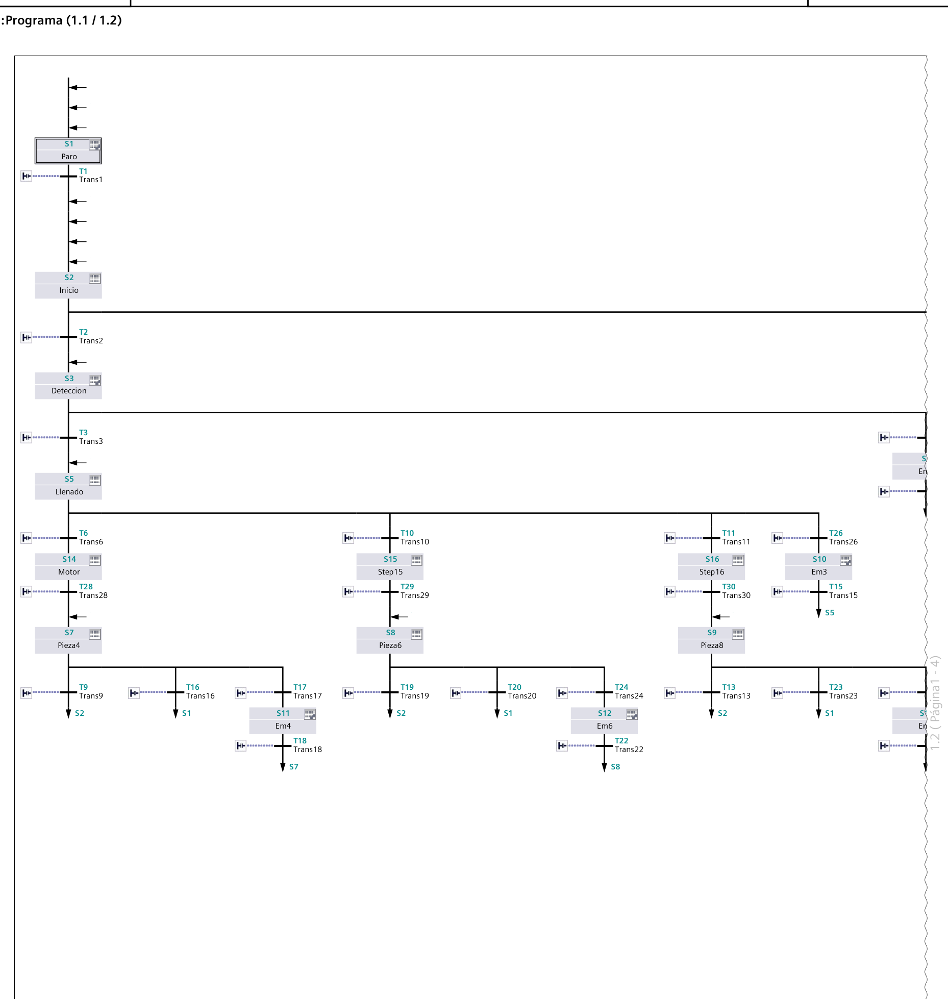
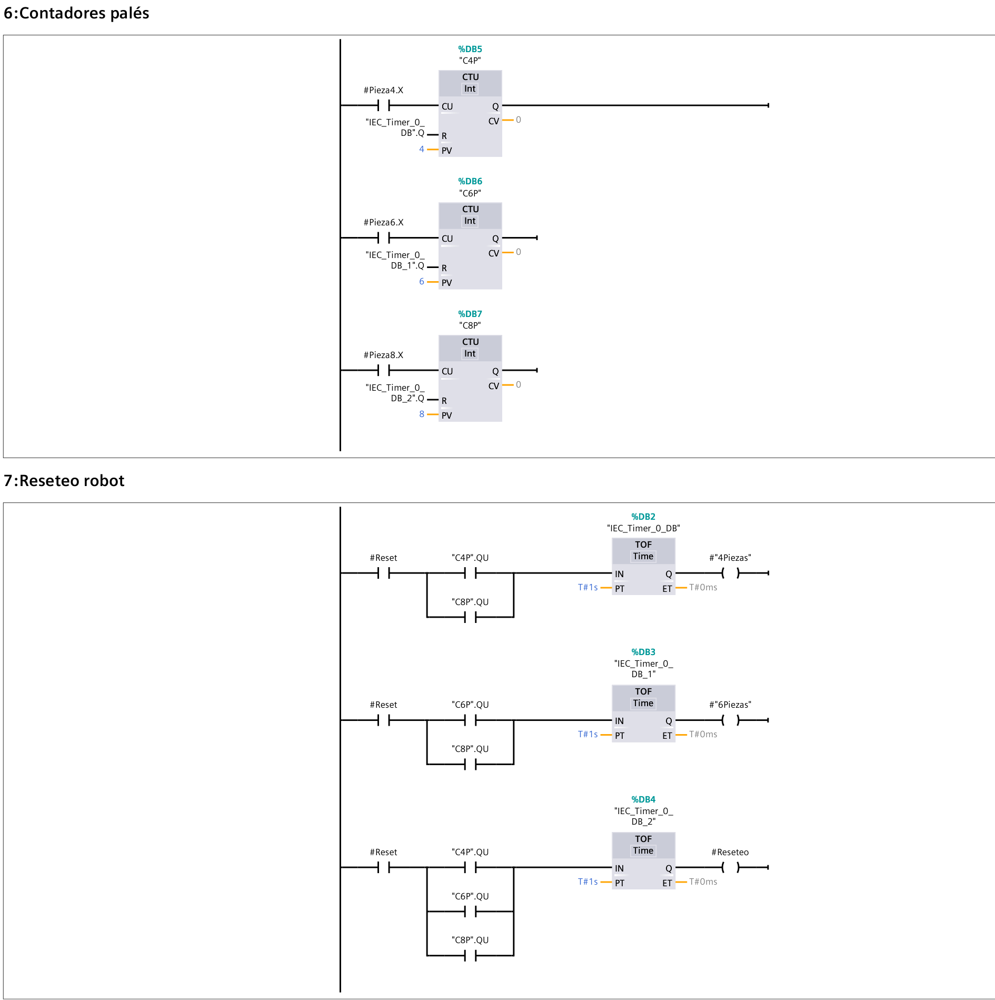
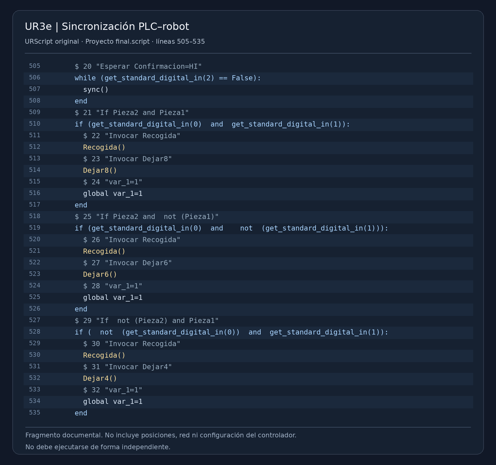

# Industrial Packaging and Robotic Palletizing — Siemens PLC & UR3e

**Academic Engineering Project | Universidad Europea de Madrid | 2025–2026**

## Project Overview

Development and physical validation of an automated packaging and palletizing system integrating a Siemens S7-1500 PLC with a Universal Robots UR3e collaborative robotic arm.

The project combined industrial process control, robot programming and digital signal coordination to automate the preparation and handling of containers.

The complete process was implemented and tested in a university robotics laboratory.

## Technologies and Equipment

- Siemens S7-1500 PLC
- Siemens TIA Portal V16
- Siemens GRAPH and KOP (Ladder Logic)
- Universal Robots UR3e collaborative robot
- PolyScope and URScript
- Digital input/output signals
- Sensors and industrial actuators
- SolidWorks for auxiliary mechanical components

## System Architecture

The system integrates two main control elements.

### Siemens PLC — Industrial Process Control

The PLC manages the automation sequence of the packaging station.

Main functions:

- Selection of container formats
- Control of actuators and process sequences
- Processing of sensor signals
- Management of timers and counters
- Coordination with the robot using digital I/O
- Emergency stop and restart logic

The system was designed to handle containers with 4, 6 and 8 parts.

### UR3e — Robotic Manipulation

The UR3e performs the programmed manipulation and palletizing operations.

Main functions:

- Execution of predefined robot movements
- Handling and positioning of containers
- Synchronization with the PLC
- Execution of sequences based on digital signals

## Operational Workflow

1. The operator selects the required container format.
2. The Siemens PLC controls the packaging sequence.
3. Sensors and actuators manage the preparation of the container.
4. The PLC coordinates the operation with the UR3e.
5. The robot executes the handling and palletizing sequence.
6. The system continues according to the programmed control logic.

## Programming and Integration

The industrial control logic was developed using Siemens TIA Portal V16.

The PLC programming included sequential control using GRAPH and logic implemented in KOP.

The UR3e was programmed using PolyScope and URScript.

Digital signals were used to coordinate the two systems and manage the execution of the automated process.

The team also carried out debugging and adjustments during integration.

## Mechanical Design

Auxiliary mechanical components were designed using SolidWorks to support the robotic handling process.

These elements complemented the programming and system integration work.

## Validation and Results

The project was tested using the physical equipment available in the university laboratory.

**Verified outcomes:**

- PLC and robot programming completed
- Digital communication and coordination established
- Automated packaging and handling sequences executed
- Integration errors identified and corrected
- Complete process successfully demonstrated during final testing

The project demonstrates practical integration of industrial control and robotics.

## Project Gallery

The following images document the physical system and selected
programming elements developed during the project.

### 1. Industrial Packaging Workstation

Physical workstation used for container handling and automated
packaging operations.

### 2. UR3e Gripper and Positioning Fixture

Detail of the robotic handling equipment and auxiliary fixture.

### 3. Siemens GRAPH — Sequential Control

Sequential logic implemented in TIA Portal for the automated
packaging process, including different container formats.

### 4. Siemens KOP — Counters and Reset Logic

Ladder logic showing part counters and system reset functions.

### 5. UR3e — URScript Programming

Selected programming fragment illustrating digital I/O
synchronization and robotic handling sequences.

## Project Limitations

- Developed in a controlled academic laboratory
- No industrial production-rate benchmark was established
- The implementation has not been validated for continuous industrial operation
- The published documentation excludes internal laboratory configurations

## Project Team

- César Malitaxi Martínez
- Jorge Riofrio Huerta
- Marcos Sanjuan Rodríguez
- Pau Costa Torres

**Course:** Industrial Robotics / Industrial Automation  
**University:** Universidad Europea de Madrid  
**Academic year:** 2025–2026

Collaborative academic project involving PLC programming, robot programming, debugging, mechanical design and physical system validation.

## Technical Documentation

Selected programming examples, diagrams and project photographs will be incorporated after reviewing the files for publication.

Original laboratory configuration files and sensitive access information will not be published.
